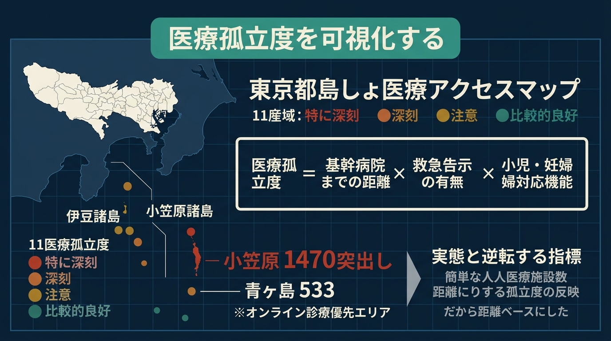
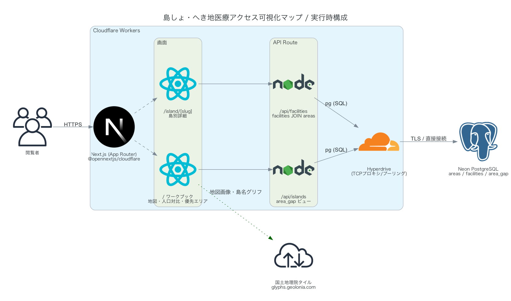
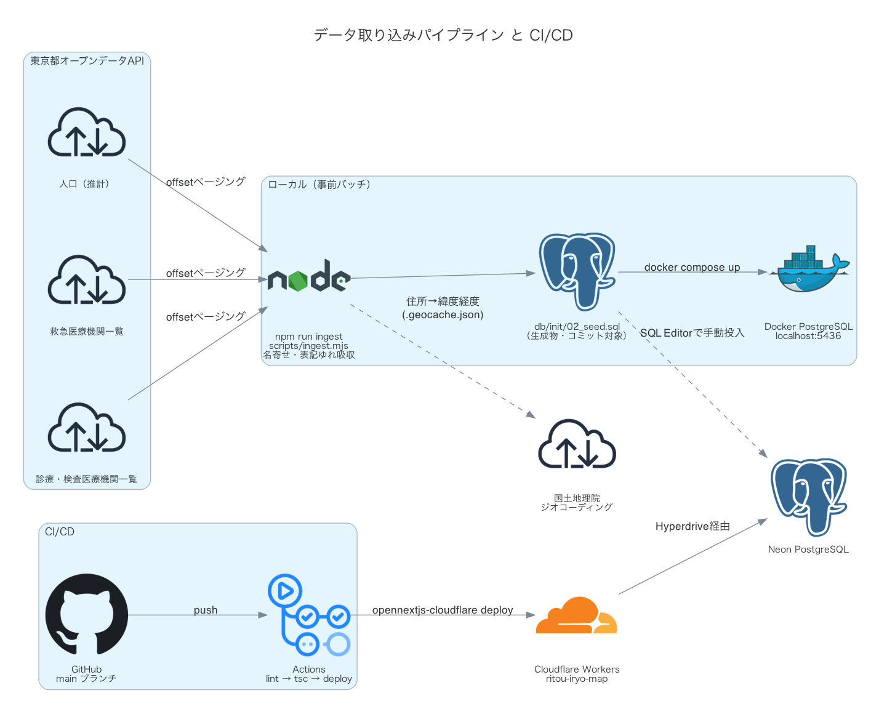

# 島しょ・へき地医療アクセス可視化マップ



東京都の島しょ部（伊豆諸島・小笠原諸島）と西多摩へき地の医療アクセスの実態を可視化し、  
オンライン診療の優先導入エリアを提案するマップです。

- **公開URL**: https://ritou-iryo-map.tokyo-odh-039.workers.dev/
- **計算方法のページ**: [/methodology](https://ritou-iryo-map.tokyo-odh-039.workers.dev/methodology)（スコアの算出方法とデータについて）

トップページ（`/`）は、地図・ランキング・比較チャートをすべて含む1画面のワークブックになっています。

## 目次

- [開発の経緯](#開発の経緯) / [企画背景](#企画背景) / [できること](#できること)
- [技術スタックと選んだ理由](#技術スタックと選んだ理由) / [アーキテクチャ](#アーキテクチャ)
- [地図の作り方](#地図の作り方) / [ジオコーディングと距離の計算](#ジオコーディングと距離の計算)
- [ギャップスコア（医療孤立度）の算出方法](#ギャップスコア医療孤立度の算出方法)
- [使用オープンデータ](#使用オープンデータ東京都オープンデータapi動作確認済み) / [データの取得タイミング](#データの取得タイミング)
- [品質の確かめ方](#品質の確かめ方) / [既知の制約](#既知の制約) / [今後の改善](#今後の改善)

## 開発の経緯

ハッカソン向けに個人で開発しました。  
期間は約1週間で、ほかの作品と並行して作っています。

## 企画背景

東京都は伊豆諸島・小笠原諸島などの島しょ部を抱えており、医療資源が本土と大きく異なります。  
チームみらいの医療政策「オンライン診療/処方受け取り方法を充実し、通院のない受診を実現」のうち、  
特に「島しょ部の僻地医療」を対象にしています。  
医療アクセスの実態を可視化し、オンライン診療導入の優先エリアを特定することが狙いです。  
対象は島しょ9町村と、比較軸としての西多摩へき地2町村（檜原村・奥多摩町）の計11エリアです。

## できること

トップページ（`/`）内のタブで切り替えます。  
ページ遷移せずに、地図・一覧・詳細を行き来できます。

- **地図＋ランキング**（`/#map`）: 島しょ9町村と西多摩へき地2町村を色分けしたバブルで表示します（円の色=ギャップの深刻度、円の大きさ=人口）。  
  右側のランキングやマップ上の島をクリックすると、その場に詳細パネル（医療機関一覧・本土への移動手段・距離定規）が開きます。  
  ズームすると医療機関のピン（救急=赤/診療所=青緑）が表示されます。  
  小笠原は本土から約1,000km南にあるため、ジャンプボタンで移動します
- **人口対比**（`/#compare`）: 人口と医療機関数を対比したチャートです
- **優先エリア提案**（`/#priority`）: ギャップスコアのランキングチャートと、オンライン診療導入の優先エリアを提案するテーブル（理由は自動生成）です。  
  エリア名をクリックすると、地図タブの詳細パネルが開きます
- **島別詳細**（`/island/[slug]`）: 上記の詳細パネルをフルページにしたものです。  
  人口・世帯・面積・医療機関一覧・移動手段・距離・島内ミニマップを含み、共有用のリンクとして使います
- **計算方法**（`/methodology`）: スコアの算出方法と使用データを説明しています

データはすべて東京都オープンデータAPIから取得しています（11エリア・医療機関16か所・うち救急3か所）。

## 技術スタックと選んだ理由

選ぶときの条件は「個人開発なので、無料枠で公開し続けられること」です。

| 領域 | 使っているもの | 選んだ理由・使い方 |
| :--- | :--- | :--- |
| アプリ | Next.js 16（App Router）＋ React 19 | 画面と API Route（`/api/islands`・`/api/facilities`）を1つのアプリで持てるためです |
| 実行環境 | Cloudflare Workers | 無料枠で常時公開できるためです。アダプターは `@opennextjs/cloudflare`（`open-next.config.ts`・`npm run cf:deploy`）を使っています。R2 などのキャッシュ用リソースは使わない最小構成です |
| DB | Neon PostgreSQL | 無料枠のあるマネージド PostgreSQL です。ローカル開発では Docker の PostgreSQL（`docker-compose.yml`）を使い、スキーマは共通です |
| DB接続 | Cloudflare Hyperdrive ＋ `pg` / `pg-cloudflare` | Workers はリクエストをまたいで DB 接続を持てません（別のリクエストで張ったソケットを触ると例外になります）。そのため `lib/db.ts` ではクエリごとに `Client` を張って閉じ、接続の使い回しは Hyperdrive の接続プールに任せています。ローカルでは `Pool` を使います |
| 地図 | MapLibre GL JS 5（`maplibre-gl@5.24.0`） | APIキーが不要なオープンソースで、データから色や大きさを決める式（expression）が使えるためです |
| 背景地図 | 国土地理院 淡色地図（`cyberjapandata.gsi.go.jp/xyz/pale`） | APIキーが不要で、色が薄く、上に重ねた円やピンが目立つためです |
| 文字（グリフ） | Geolonia のグリフ（`glyphs.geolonia.com`、`Noto Sans CJK JP Regular`） | 地図上に日本語の島名ラベルを出すためです |
| グラフ | Recharts | 人口対比・ランキングのチャートに使っています |
| CI/CD | GitHub Actions | lint・型チェック・ビルドが通ってから Workers にデプロイします（`.github/workflows/deploy.yml`） |

## アーキテクチャ

### 実行時構成



Cloudflare Workers 上の Next.js（App Router）が画面とAPI Routeの両方を担い、  
DBアクセスは Hyperdrive 経由で Neon PostgreSQL に届きます。  
アプリから出る外部通信は地図タイル（国土地理院）と島名グリフだけで、APIキーは不要です。

### データ取り込みと CI/CD



東京都オープンデータAPIへの通信は、`npm run ingest` による事前バッチのときだけです。  
生成した `db/init/02_seed.sql` を、ローカルの Docker（開発）と Neon（本番）に投入します。  
`main` に push すると、GitHub Actions が lint → 型チェック → ビルド → Workers へのデプロイを実行します（PR では check までです）。

## 地図の作り方

### データの渡し方

- API（`/api/islands`・`/api/facilities`）は DB の行をそのまま JSON で返します。  
  ブラウザ側（`app/components/Workbench.tsx`）で GeoJSON の `FeatureCollection`（Point）に組み立て、MapLibre の `geojson` ソースに `setData` で渡しています
- ベクタータイルにしていないのは、データが11エリア・医療機関16か所と少なく、全件を一度に送っても軽いためです。  
  タイルを生成・配信する仕組みを持たずに済みます

### 円の大きさ・色を式（expression）で決める

円の見た目は JavaScript で1件ずつ計算せず、MapLibre の式を使ってデータの値から決めています。

```ts
// エリアの円: 半径は人口の平方根に比例（面積が人口に比例するように）
"circle-radius": ["+", 7, ["*", 0.16, ["sqrt", ["get", "population"]]]],
// 色はギャップのレベルで塗り分け
"circle-color": ["match", ["get", "level"],
  "critical", LEVELS.critical.color, "high", LEVELS.high.color,
  "moderate", LEVELS.moderate.color, "low", LEVELS.low.color, "#94a3b8"],

// 医療機関のピン: 救急かどうかで大きさと色を変え、ズーム8.5以上で表示
"circle-radius": ["case", ["get", "is_emergency"], 8, 6],
"circle-color": ["case", ["get", "is_emergency"], "#dc2626", "#0d9488"],
```

`level` は、ブラウザ側で `gapLevel()`（`lib/gap.ts`）がスコアから決め、GeoJSON の properties に入れています。

### 座標系

- 座標は WGS84（EPSG:4326）の緯度経度で持っています（DB の `lat` / `lng` は `double precision`）
- 表示は MapLibre 標準の Web メルカトルです

### 小笠原をジャンプボタンにした理由

小笠原は本土から約1,000km離れています（基幹病院までの直線距離は 979.9km）。  
伊豆諸島と同じ画面に入れると、ほかの島が小さくなってしまいます。  
そのため「伊豆諸島」「小笠原」「西多摩」の3つの表示範囲をボタンで切り替え、`fitBounds` で移動するようにしています。

## ジオコーディングと距離の計算

どちらも取り込み時（`scripts/ingest.mjs`）に行い、結果を DB に入れています。  
アプリの実行中には計算しません。

### 住所 → 緯度経度

1. 国土地理院のジオコーディングAPI（`msearch.gsi.go.jp/address-search/AddressSearch`）で、医療機関の住所を緯度経度に変えます。  
   候補の先頭1件を採用します
2. 変換した座標が、エリアの中心（役場付近）から30km以内にあるかを Haversine 式で確かめます
3. 30kmより外れたもの、または変換できなかったものは、除外せずにエリアの中心に置き、`geocode_fallback = true` の印を付けます。  
   島の医療機関は少なく貴重なためです

現在のデータでは、16か所のうち4か所に印が付いています（八丈島2・三宅島1・小笠原1）。

- 結果は `scripts/.geocache.json` にキャッシュしています（git 管理外）。  
  API への連続アクセスは150msずつ間をあけています

### 基幹病院までの距離

- 各エリアの中心から基幹病院（都立広尾病院）までの距離を、Haversine 式（地球を半径6,371kmの球とみなした2点間の距離）で計算し、  
  `areas.distance_to_hub_km` に入れています
- 値は 52.0km（檜原村）〜 979.9km（小笠原）です

### PostGIS を使っていない理由

距離を出すのは11エリアと基幹病院の間だけで、アプリの実行中に「近くの医療機関を探す」といった空間検索はしていません。  
そのため、普通の PostgreSQL で足りると判断しました。  
件数が増えて、実行中に距離で絞り込むようになったら、  
PostGIS の `geography` 型と `ST_DWithin`、GiST インデックスに移す予定です。

## ギャップスコア（医療孤立度）の算出方法

```
gap_score = 基幹病院（都立広尾病院）までの直線距離km
            × 救急補正（救急告示医療機関なし: ×1.5）
            × 医療機能補正（小児対応なし: ×1.2、妊婦対応なし: ×1.2、医療機関ゼロ: ×2）
```

| スコア | レベル |
| :--- | :--- |
| 500以上 | 特に深刻（赤） |
| 250以上 | 深刻（オレンジ） |
| 150以上 | 注意（黄） |
| 150未満 | 比較的良好（緑） |

- 算出は DB の `area_gap` ビュー（`db/init/01_schema.sql`）にまとめていて、フロントはビューを読むだけです。  
  係数を差し替えるときは、このビューの一か所を直せば済みます
- 補助指標として「一機関あたり人口 `pop_per_facility`」も算出しています
- 基幹病院には、島しょ医療の支援を担う都立広尾病院を採用しています
- 主指標を「人口÷医療機関数」ではなく **孤立度ベース（距離×救急補正×医療機能補正）** にしたのは、  
  人口比だと人口が最も多い大島が1位、最も孤立した青ヶ島が最下位になり、政策の優先度として実態と逆になるためです

### 係数としきい値について

- 係数（×1.5、×1.2、×2）としきい値（500・250・150）は、統計的な根拠のある値ではなく、仮に置いた重みです
- 決め方: 救急がないことを一番重く見る順番（救急なし ×1.5 ＞ 小児・妊婦なし 各 ×1.2）を先に決め、  
  計算結果の順位が実態とずれていないかを確かめました
- しきい値は、実際のスコアの分布（59〜1470）を4段階に分けられるように置いています（`lib/gap.ts` の `gapLevel()`）

## 使用オープンデータ（東京都オープンデータAPI・動作確認済み）

| データ | 提供元 | API ID |
| :--- | :--- | :--- |
| 東京都の人口（推計） | 東京都総務局 | `t000003d2000001071-2f426fdbb32719c7530fa29ffee71129-0` |
| 救急医療機関一覧 | 東京都保健医療局 | `t000055d0000000356-ca6cc0d345b4afab5569dca8d7fb47e0-0` |
| 診療・検査医療機関の一覧 | 東京都保健医療局 | `t000055d0000000391-c5bbc28a5a7899eca7b4ec57c3ba03be-0` |

- 島しょ町村単体の医療機関一覧はオープンデータカタログに登録されていないため、  
  上記の全都データから対象自治体の分を抽出しています
- 2つの医療機関データは、名称から空白・法人格（医療法人社団など）・「国民健康保険」を除いた名前で名寄せし、  
  重複するものは機能フラグをまとめています
- 「診療・検査医療機関の一覧」は発熱外来の届出情報をもとにしているため、小児・妊婦・検査の対応状況は掲載時点のものです
- 本土への移動手段（船・飛行機・ヘリなど）はオープンデータに存在しないため、  
  一般的な交通情報を島マスタとして静的に定義しています

## データの取得タイミング

東京都オープンデータAPIへの通信は **事前の取り込み時だけ** で、アプリの実行中は DB だけを参照します。

| タイミング | 通信先 | 内容 |
| :--- | :--- | :--- |
| 事前（`npm run ingest` 実行時） | 東京都オープンデータAPI | 人口・救急医療機関・診療検査医療機関を取得し、`db/init/02_seed.sql` を生成 |
| 事前（同上） | 国土地理院ジオコーディングAPI | 医療機関の住所を緯度経度に変換 |
| DB起動時（`docker compose up`） | なし | 生成済みのSQLをPostgreSQLに自動投入 |
| アプリ実行中 | 国土地理院タイル・島名グリフのみ | 地図画像の表示。医療機関・人口はDBから取得 |

## 品質の確かめ方

- CI（GitHub Actions）で lint（ESLint）・型チェック（`tsc --noEmit`）・Next.js のビルドが通ってから、  
  Cloudflare Workers にデプロイしています
- 取り込み時には、自治体ごとの医療機関件数と、ジオコーディングの成功・フォールバック件数をコンソールに出し、目で確かめています

## 既知の制約

- 医療機関の網羅性は、「救急医療機関一覧」と「診療・検査医療機関の一覧」の掲載範囲に依存します。  
  正式な診療科目一覧（例: 資料第37 島しょ医療機関一覧）はPDFのみでAPI化されていないため、  
  診療科目の代わりに医療機能フラグ（救急/小児/妊婦/検査）で表現しています
- 基幹病院までの距離は直線距離で、実際の搬送時間（船・ヘリの就航率など）は反映していません。  
  交通手段カードの記載は参考情報です
- 医療機関16か所のうち4か所は、住所の座標を使えず、エリアの中心（役場付近）に置いています（`geocode_fallback` フラグ）。  
  小笠原村のエリア中心は父島にあり、約50km離れた母島の診療所は、正しい座標が取れても30km以内の確認で外れるため、  
  父島の位置に表示されています
- ジオコーディングでは候補の先頭1件だけを使っています
- オープンデータの取り込みは手動（`npm run ingest`）で行っています
- 新島村は新島・式根島の2島を持ちますが、人口統計が村単位のため、1エリアとして扱っています

## 今後の改善

- 直線距離ではなく、船・ヘリの所要時間や就航率で距離を出す
- オープンデータを定期的に自動で取り込み直す
- テストを足す（取り込み処理とスコア計算から）
- 件数が増えたら、ベクタータイルでの配信やクラスタリングに移す
- 1つのエリアに複数の島がある場合（小笠原村の父島・母島、新島村の新島・式根島）に、  
  島ごとの中心でジオコーディング結果を確かめる
